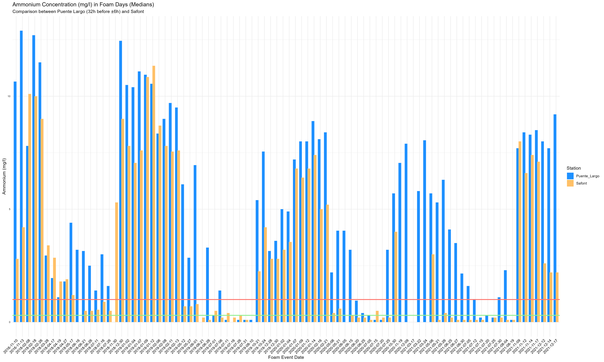
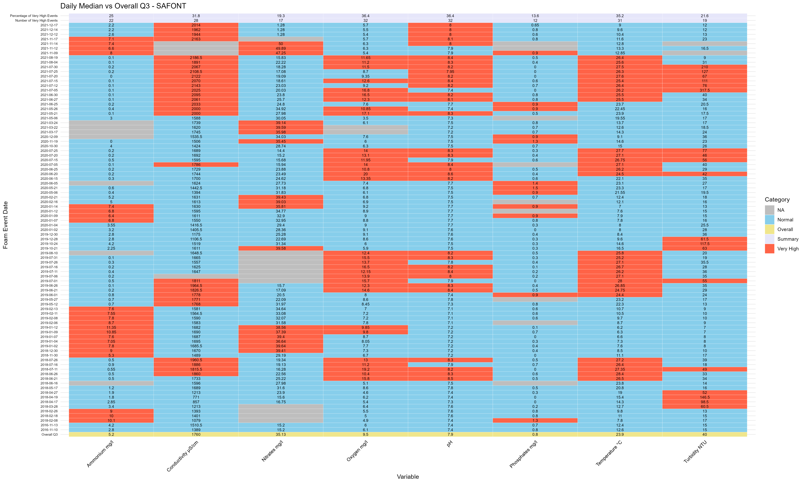
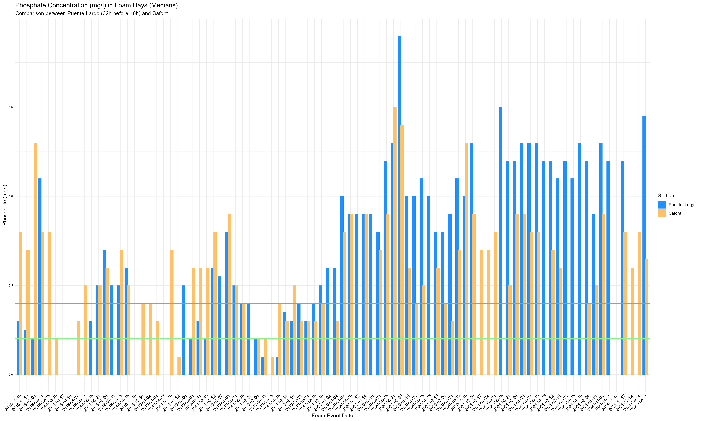

# Predicting Foam Events on the Tagus River (Toledo, Spain)

Data analysis and machine learning on river water quality and satellite foam observations.
Built during my data science internship with the Cátedra del Tajo (UCLM-SOLISS), Toledo, Spain, summer 2025.

**Tools:** R, tidyverse, lubridate, ggplot2, caret, rpart, randomForest

## The question

Foam appears on the Tagus River near Toledo on some days and not others. Which measurable water-quality conditions go with foam events, and can they predict one?

## Data

| Source | What it is | Size |
|---|---|---|
| Copernicus satellite data | Daily foam observations (foam / no foam) | 393 days (198 foam, 195 no foam) |
| Safont monitoring station | Temperature, pH, conductivity, oxygen, turbidity, ammonium, phosphates, nitrates | 161,849 readings, 2016 to 2021 |
| Matched dataset | Days with a foam label and at least one water measurement | 178 days |

> The raw data belongs to the research group and is not included in this repository.

## Methods

1. **Cleaning and merging (R).** Trimmed whitespace, parsed dates and times with lubridate, joined satellite and station data on timestamp, dropped rows with no measurements, and translated the column names from Spanish to English.
2. **Group comparison.** Compared foam days with non-foam days on 8 variables using a bootstrap test on the difference in medians. This avoids assuming normal data. Repeated the tests on cold days only (at or below the 17.3°C median) and warm days only.
3. **Logistic regression.** Fit foam vs. temperature, river flow, and ammonium to see the direction and size of each effect.
4. **Decision trees.** Tried different variable sets with `rpart`, using 10-fold cross-validation repeated 100 times with different seeds.
5. **Random forest.** Fit a forest on five predictors with 10-fold cross-validation, because ammonium and temperature are strongly correlated and hurt the trees when used together.

## Results

**Foam days were colder and richer in nutrients.** Significant differences (p < 0.05) on foam days:

| Variable | Result |
|---|---|
| Temperature | Lower (p < 0.001) |
| Conductivity | Different (p = 0.001) |
| Nitrates | Different (p = 0.001) |
| Ammonium | Higher (p = 0.007) |
| pH | Different (p = 0.029) |

Oxygen, turbidity, and phosphates did not separate foam from non-foam days.

**Models**

| Model | Result |
|---|---|
| Logistic regression, temperature only | 70.3% accuracy (on the training data) |
| Logistic regression, river flow | 66% accuracy |
| Decision tree, temperature only | about 72% (10-fold CV, repeated 100 times) |
| Random forest, 5 predictors | 70.9% accuracy, Kappa 0.42 (10-fold CV, 120 complete rows) |

Temperature alone predicted foam about as well as the full random forest, so most of the signal appears to be seasonal.

### Selected figures

Ammonium on foam days, median values, two stations:



Safont station: which days were "very high" (above the overall third quartile) for each variable:



Phosphates on foam days:



## Limitations

- The matched sample is small (120 to 178 rows depending on the model).
- Days close together are not independent, so random cross-validation folds can overstate accuracy. Validating on a later time period would be more honest.
- The logistic regression accuracies were computed on the training data.
- These results show association, not cause. Temperature likely stands in for season and river flow.
- Foam labels and chemistry readings are matched by date, so they may not be measured at the same moment.

## Next steps

- Validate by time period, for example train on 2016 to 2019 and test on 2020 to 2021.
- Add river flow and rainfall as predictors.
- Compare against a simple temperature baseline and tune the random forest.

## Repository

```
tagus_foam/
├── README.md
├── images/
├── espuma_de_tajo.html    # rendered report: cleaning, comparison tests, logistic regression
└── arboles.Rmd            # decision trees and random forest
```

## Author

Bennett Kohlhepp, University of Wisconsin-Madison (Computer Science, Data Science, Spanish)
GitHub: [bkohlhepp10](https://github.com/bkohlhepp10)
